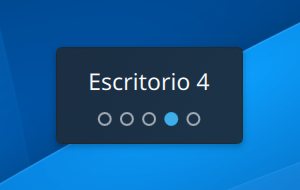

# kwin-desktop-osd

Script de KWin para **KDE Plasma 6** que muestra un popup al cambiar de escritorio virtual,
al estilo de Cinnamon: el **nombre del escritorio** y **una bolita por escritorio**, con la
actual rellena, para saber de un vistazo dónde estás y cuántos tienes delante y detrás.



- Usa los colores de tu tema de Plasma (claro u oscuro, color de acento).
- Se oculta solo a los 0,6 s; si cambias varias veces seguidas se queda y se va actualizando.
- No captura el ratón ni el teclado.
- Si tienes los escritorios en varias filas, las bolitas forman la misma rejilla.
- Funciona en Wayland y X11.

## Requisitos

- KDE Plasma 6 (probado en Plasma 6.7, Fedora 44, Wayland).
- No necesita nada más: ni compilar ni dependencias extra.

## Instalación

### Opción 1: con el script (recomendado)

```bash
git clone https://github.com/mrdic94/kwin-desktop-osd.git
cd kwin-desktop-osd
./install.sh
```

Por defecto se instala como **enlace simbólico** al repositorio, así que no borres ni muevas
la carpeta. Para actualizar más adelante basta con `git pull` y volver a iniciar sesión.

Si prefieres copiar los archivos (y poder borrar el repositorio después):

```bash
./install.sh --copy
```

Después, **cambia de escritorio** (por ejemplo, <kbd>Ctrl</kbd>+<kbd>Meta</kbd>+<kbd>←</kbd>/<kbd>→</kbd>)
y debería aparecer el popup. Si no aparece, cierra sesión y vuelve a entrar.

### Opción 2: a mano

```bash
git clone https://github.com/mrdic94/kwin-desktop-osd.git
kpackagetool6 --type KWin/Script --install kwin-desktop-osd/package
```

Luego actívalo en **Preferencias del sistema → Gestión de ventanas → Scripts de KWin**,
marcando **Desktop Name OSD** y pulsando **Aplicar**.

## Ponerle nombre a los escritorios

El popup muestra el nombre de cada escritorio. Por defecto son «Escritorio 1», «Escritorio 2»…
Para cambiarlos: **Preferencias del sistema → Escritorios virtuales**, doble clic sobre el
nombre, escribe uno nuevo (por ejemplo «Código», «Correo», «Música») y **Aplicar**.

## Personalizar

Todo está en [`package/contents/ui/main.qml`](package/contents/ui/main.qml), al principio:

| Propiedad    | Por defecto | Qué hace                                         |
|--------------|-------------|--------------------------------------------------|
| `hideDelay`  | `600`       | Milisegundos que el popup sigue visible          |
| `sizeFactor` | `0.7`       | Tamaño del popup (`1.0` más grande, `0.5` menor) |

> **Importante:** KWin guarda el script en caché. Tras editar `main.qml` hay que **cerrar
> sesión y volver a entrar** para ver los cambios; desactivarlo y activarlo no basta.

## Desinstalar

```bash
./uninstall.sh
```

O desde **Preferencias del sistema → Gestión de ventanas → Scripts de KWin**.
Si lo instalaste con `kpackagetool6`:

```bash
kpackagetool6 --type KWin/Script --remove desktopnameosd
```

## Problemas

- **No aparece nada:** comprueba que está activado en *Scripts de KWin* y vuelve a iniciar sesión.
  Los errores de QML salen en `journalctl --user -b | grep -i kwin`.
- **Sale dos veces:** hay dos copias cargadas (por ejemplo, instalaste con el script y con
  `kpackagetool6`). Desinstala una y vuelve a iniciar sesión.

## Licencia

[MIT](LICENSE)
